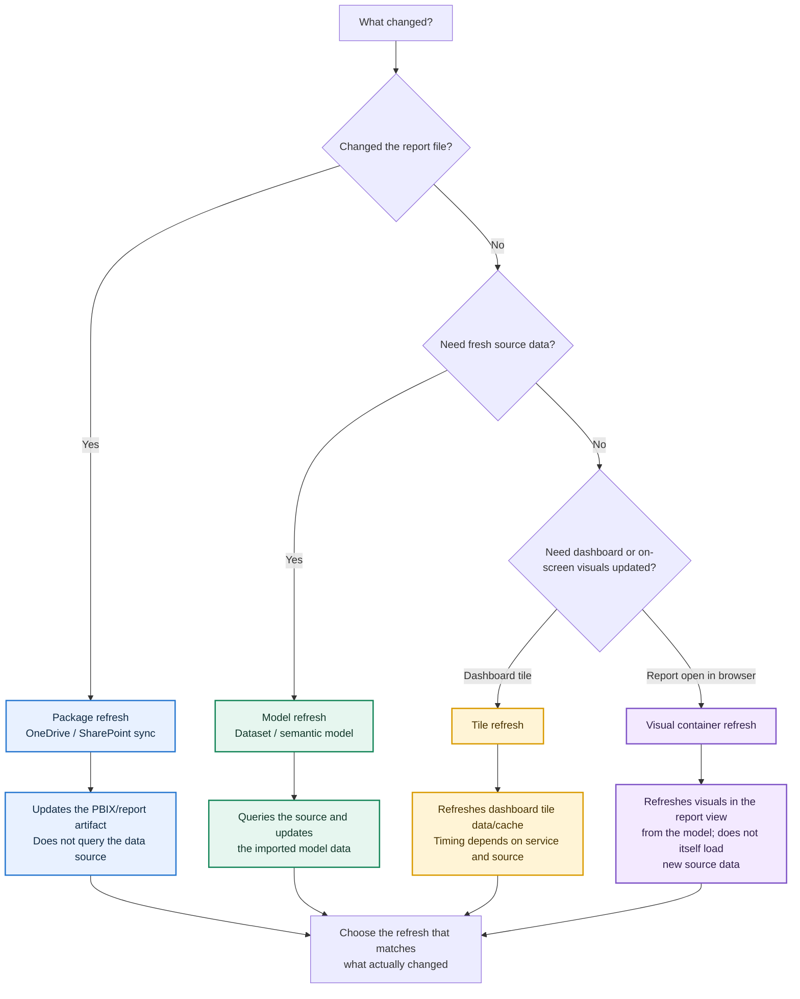

# Power BI refresh options

## Which part needs to be updated?

### Quick comparison

| Refresh option | What it updates | Typical use |
|---|---|---|
| **Package refresh** | The report/package file synced from OneDrive or SharePoint Online. It does **not** refresh the underlying model data by itself. | A PBIX was edited and saved to OneDrive or SharePoint, and the Service should pick up those file changes. |
| **Model (data) refresh** | Data in the dataset/semantic model, by querying its connected sources. | Bring imported data up to date on a schedule or with a manual refresh. |
| **Tile refresh** | Dashboard tile data/cache. This is separate from loading new data into the model, and its timing depends on the service and configuration. | Update dashboard tiles after the model changes, or refresh a tile when needed. |
| **Visual container refresh** | Visuals in an open report view using the model's available data. It does not independently query the original source for new model data. | Update the report's displayed visuals; use model refresh when the source data itself must be reloaded. |

> **Interview takeaway:** Match the refresh to the layer that changed: the **file**, the **model data**, the **dashboard tile**, or the **report view**. For example, after a PBIX edit stored in SharePoint, package refresh syncs the file; a separate model refresh may still be needed to load new source data.
